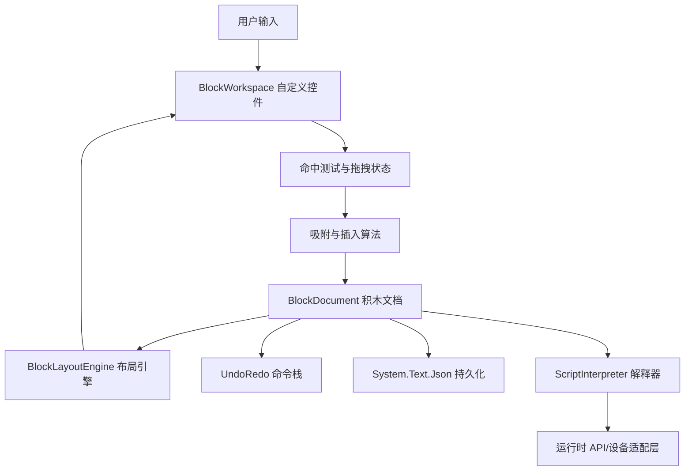
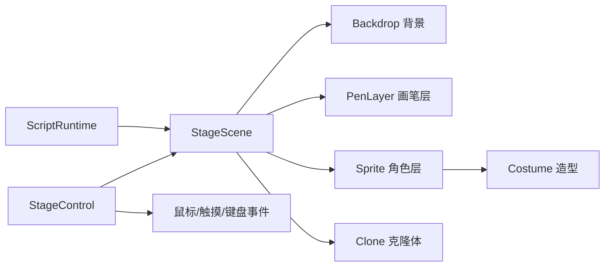

fx

# 项目实施方案

## 目录

1. [多智能体工作台计划](#多智能体工作台计划)
2. [Scratch 风格积木编辑器方案](#scratch-风格积木编辑器方案)
3. [Python 编辑页与积木双向同步方案](#python-编辑页与积木双向同步方案)

## 当前实现状态

### 已实现

- Avalonia 桌面应用外壳、主窗口、侧栏、设置、主题、窗口布局持久化和页面导航。
- 项目创建/打开/关闭/切换、`project.json`、多文件脚本、资源管理和最近项目记录。
- v1/v2/v3 对象脚本模板、区域投影、系统代码隐藏、保存冲突检查和显式模板升级。
- Python 编辑页使用 `AvaloniaEdit.TextEditor`，支持语法高亮、诊断、引用查询、导入管理和缩进转换。
- Python Helper 的 stdio JSON-RPC、AST 诊断、模块引用、重命名、对象脚本识别和积木投影。
- 独立 Python 运行时：事件循环、初始化、启动、点击、消息广播、按键、计时器、背景切换、克隆体、动画和 `wait`。
- 舞台静态布局、对象管理器、造型管理、运行时预览、角色拖动和碰撞箱调试显示。
- 项目级变量与列表：`project.json` 持久化、管理对话框、变量/列表引用检查、安全重命名和删除保护。
- 运行时数据 API：`get_variable`、`set_variable`、`add_to_variable`（`change_variable` 兼容别名）、列表操作和 `list_values`。
- 旋转矩形碰撞：按当前造型尺寸、当前缩放和方向计算；支持角色/克隆体、指针、边缘和调试碰撞箱。
- 图形化编辑区外壳和只读积木投影：解析 `start` 区域，支持运动、等待、重复、条件、变量和造型积木；未支持代码保留为原始块。
- 单个 Scratch 风格积木控件原型：自定义绘制蓝色运动积木、参数槽和积木轮廓，已用于移动/旋转积木预览。
- 测试覆盖项目、运行时、脚本区域、重命名、数据管理、碰撞和积木投影；当前 C# 全量测试通过。

### 待实现

- 完整 Scratch 风格自定义积木控件：帽子/C 型轮廓、动态参数编辑、连接口、拖拽和吸附；当前仅有单个命令积木原型。
- 积木编辑：从分类插入、修改参数、删除、移动、嵌套、撤销重做和 Python 写回。
- 完整积木与 Python 双向同步；未支持 Python 代码的稳定原始块映射。
- 完整 LSP 客户端、语义补全、跳转和跨文件工作区同步。
- 像素级碰撞、颜色碰撞和更精细的舞台侦测；当前保留旋转矩形碰撞。
- 声音、画笔、自定义积木和其他 Scratch 扩展能力。
- Python/Git 安装门禁、内置/外部环境版安装包、Git 版本管理和跨平台发布。
- 安装器、真实键鼠/视觉验收和完整跨平台回归。

## 多智能体工作台计划

## 问题与目标

在当前空工作区中从零建立一个 Avalonia 桌面应用宿主，并将多智能体工作台实现为其中一个可切换的页面，而不是独立主窗口或应用唯一页面。用户可以从宿主导航进入/离开工作台，在工作台内管理会话、选择/切换智能体角色，查看消息与工具调用过程，并跟踪任务状态。目标用户位于中国大陆，因此真实模型接入优先考虑大陆网络可直接访问、提供中文文档与支付/实名认证流程的国内官方服务。首版先用模拟客户端完成 UI；真实服务采用可替换的供应商适配器，并允许用户配置自己的 API Key。免费额度和可用模型随服务商、账户、地区及时间变化，应用不承诺永久免费或提供共享的开发者密钥。

## 实施流程

### 阶段 1：环境与项目骨架

1. 在仓库根目录检查是否已有项目文件或本地指引；本计划当前面向空工作区。先用 `dotnet --info` 确认 .NET SDK、目标平台和运行时，用 `dotnet new list` 检查 Avalonia 模板是否可用。若没有模板，先确认官方模板包的当前安装方式和版本，再安装，不在未经检查时固定版本。
2. 创建解决方案、Avalonia 桌面应用和测试项目。建议分层为 `src/<AppName>/` 与 `tests/<AppName>.Tests/`，采用项目模板生成基础启动代码，不手工重写框架入口。按本机模板提供的桌面平台配置决定 Windows/macOS/Linux 支持范围。
3. 运行 `dotnet restore`、`dotnet build` 和模板自带的启动方式，先验证空白应用可构建、可启动。记录最终 .NET/Avalonia 版本及实际命令。

**验收：** 解决方案可还原、构建，Avalonia 空窗口能启动；项目结构和模板版本已确认。

### 阶段 2：领域模型与接入边界

1. 定义模型：`AgentRole`、`Conversation`、`ChatMessage`、`ToolCall`、`TaskRun`，以及消息方向、工具状态和任务状态枚举。为 UI 展示准备稳定 ID、时间戳和错误摘要，不将模型供应商专属字段放入 UI 模型。
2. 在解决方案中把供应商协议隔离在独立适配器中，并先定义统一 `IAgentClient` 契约；配置层保存供应商、模型 ID、API 地址（如供应商允许自定义）和认证引用，不把凭据直接放进普通设置文件。接口需支持流式事件、超时、取消和可识别的配额/认证错误。
3. 首选候选服务按大陆可用性调研：优先评估阿里云百炼（通义千问）、火山引擎（豆包）和智谱开放平台；首个真实适配器在确认账户注册、实名认证、充值/免费额度、模型可用性、服务条款及大陆网络实测后再选定。不要只依据“免费”宣传或历史免费额度作决定；免费额度可能限时、限新用户、限模型、限调用速率，甚至需要绑定支付方式。
4. 每个供应商实现独立配置和健康检查，例如 `QwenAgentClient`、`DoubaoAgentClient`、`ZhipuAgentClient`。模型名、区域、端点和免费/计费标记放在可更新配置/模型目录中，不散落在 UI 或业务代码中；供应商故障时提示用户选择已配置的备用适配器，不静默跨供应商发送数据。
5. 提供 `FakeAgentClient` 供无网络、无密钥场景演示和测试，保证核心 UI 功能不依赖注册任何云端账户。后续可以增加用户自托管兼容 OpenAI API 的服务端点，但必须由用户自行确认该端点在其网络环境可达及其数据政策。

**工具：** `dotnet` CLI 管理解决方案、项目和包；IDE 的 C# 语言服务用于导航/诊断；`dotnet build` 快速验证契约。

**验收：** UI 可通过接口调用模拟客户端，事件顺序可预测，取消能够停止后续事件，失败可被上层观察。

### 阶段 3：应用宿主与页面导航

1. `MainWindow` 从左到右固定组织为：不可移动的侧栏、辅助视图、主页面。侧栏固定最左，辅助视图与主页面允许互换左右位置；互换不得改变侧栏位置。窗口缩小时，面板可收缩或滚动，避免互相遮挡。
2. 侧栏左上区域按钮自上而下为：项目管理、切换到编辑器模式、切换到智能体模式、文本查找、在线教程。左下区域自下而上为：设置、账号、版本/快照管理。
   - **项目管理界面**：点击项目管理后，在主页面上方显示主窗口内的浮动覆盖界面，不创建独立窗口且不可移动。界面列出最近项目，并提供新建、打开项目和导入项目入口；关闭后返回打开前的主页面。选择或创建项目后进入对应项目工作区。
   - **设置界面**：点击设置后，在主页面上方显示主窗口内的浮动覆盖界面，不创建独立窗口且不可移动。左侧为设置分类，右侧显示所选分类的具体选项；关闭后返回打开前的主页面。设置中提供启动行为选项：`从最近的项目启动` 或 `从开始页面启动`。
   - 账号和版本/快照管理按各自功能界面打开，不改变侧栏固定位置及主页面/辅助视图布局规则。
3. **开始页面与启动行为**：开始页面采用“最近项目启动页”设计，作为主页面区域的空项目状态，而不是独立窗口。用户选择 `从开始页面启动` 时，应用启动后主页面显示欢迎信息、最近项目列表，以及新建项目、打开项目和导入项目入口；没有最近项目时显示明确的空状态引导。用户选择 `从最近的项目启动` 时，应用启动后自动打开最近可用项目；没有可用最近项目时回退到开始页面。关闭当前项目且没有其他项目打开时，主页面回到开始页面。开始页面的项目操作也可打开项目管理覆盖界面。
4. 辅助视图由输出窗口和资源管理器组成。资源管理器提供两种模式：
   - **对象管理器**：左侧列出舞台中的角色和背景对象；右侧显示选中对象的属性设置，未选中时属性区域留空。
   - **资源筛选器**：按类型显示 Python 脚本、图片文件和 JSON 对象文件；隐藏扩展名并排除筛选范围之外的文件。筛选结果是逻辑资源集合，不要求与实际工作区目录结构一致。
     输出窗口显示程序运行输出、错误和诊断信息。辅助视图可与主页面互换位置。
5. 主页面按当前模式呈现互斥内容：编辑器模式下可在可视化积木编辑器与 Python 脚本编辑器之间切换；智能体模式下由智能体对话界面独占主页面，展示消息、输入、角色/模型选择、任务状态和工具调用过程。无项目打开时显示开始页面，不显示空白编辑器。切换模式不新开独立主窗口；会话等状态由应用级服务持有，首版在内存中保留。
6. 文本查找、在线教程等侧栏入口在主页面区域打开，不改变侧栏和辅助视图的固定职责。资源管理器所选资源可在相应编辑器中打开；切换主页面类型时不得将辅助视图内容误作主页面内容。

**工具：** Avalonia XAML、数据绑定、`DataTemplate`、`Grid`/`ScrollViewer` 等内置控件；使用 IDE XAML 预览器（若环境提供）检查布局与窄窗口下的面板互换。

**验收：** 侧栏始终固定在最左且按钮顺序正确；项目管理和设置界面均在主页面上方打开为不可移动的主窗口内覆盖层，关闭后返回原页面；设置左侧分类、右侧选项切换正常，并可选择从最近项目启动或从开始页面启动；开始页面显示欢迎信息、最近项目和新建/打开/导入入口，无最近项目时有明确空状态；项目管理可列出最近项目并进入新建/打开/导入流程；辅助视图可与主页面互换位置；对象管理器选中/未选中状态、资源筛选器类型过滤与扩展名隐藏行为正确；编辑器模式可切换积木/Python 编辑器，智能体模式下对话界面独占主页面；窄窗口下布局可用且无面板重叠。

### 项目目录与版本/快照管理

每个项目以独立目录作为工作区，并以根目录的 `project.json` 作为清单入口。场景、脚本和资源按类型组织；界面中的资源筛选器按资源类型构建逻辑列表，不要求与磁盘目录树一致。首版建议结构如下，后续可随多场景和对象复用需求扩展：

```text
<project>/
├─ project.json             # 项目 ID、名称、格式版本、入口场景和资源索引
├─ scenes/
│  └─ main.json             # 舞台、背景、角色顺序及场景属性
├─ scripts/
│  ├─ main.py               # Python 源码
│  └─ blocks.json           # 积木结构及同步所需标识/映射
├─ assets/
│  ├─ images/               # 图片、造型和背景资源
│  └─ objects/              # 可复用对象定义 JSON
└─ .git/                    # 项目本地 Git 历史
```

- 项目根目录初始化为本地 Git 仓库，以 Git 分支保存并组织版本线；分支列表中每个分支对应一条独立版本列。版本/快照管理界面提供分支列表、创建分支和合并分支操作。首版只管理本地仓库，不实现远程推送/拉取。
- 更新版本（创建快照）支持三种来源：用户主动保存、设置的固定时间间隔自动保存、用户退出程序时保存。主动保存允许填写用户备注；自动保存和退出保存分别使用 `[AUTO]`、`[EXIT]` 标识。每个版本记录创建时间，时间格式为 `yy-mm-dd_hh-mm-ss`；版本说明由用户填写的备注或对应的自动保存标识构成。
- 快照管理界面按当前分支展示版本列表；用户可查看版本创建时间及具体版本信息/描述。分支列表中的每个分支独立展示其版本列，创建分支由用户主动触发，合并分支由用户选择源分支和目标分支后发起。
- 普通自动保存负责将编辑内容写入工作区；只有上述自动快照策略触发时才创建 Git 版本，二者不可混为一谈。固定间隔、是否启用退出保存等选项由设置控制。
- 切换分支、合并或恢复版本前检查未提交修改并提示用户处理；不得静默覆盖当前工作。合并冲突需明确展示并要求解决，操作失败不得丢失工作区文件。
- 跟踪项目源文件和用户导入且项目运行所需的资源；忽略缓存、临时输出、解释器环境和构建产物。Git 不可用、仓库损坏或操作失败时给出明确提示，不静默降级或丢失工作区文件。
- `project.json` 使用稳定资源 ID、类型、逻辑名称和项目相对路径建立索引；资源显示名隐藏扩展名时，仍须使用 ID/路径区分同名资源。场景文件是场景对象关系的权威数据；Python 与积木表示需遵循双向同步方案中的冲突和源码保留规则。

**验收：** 新建/打开项目可读写清单、场景、脚本和资源；可主动创建带备注的快照、按配置生成 `[AUTO]` 快照及退出时生成 `[EXIT]` 快照；时间格式正确；分支列表按分支展示独立版本列，并支持创建和合并分支；切换、合并和恢复前能保护未提交修改并处理冲突；缓存和构建产物不会进入项目历史。

### 运行时分发与依赖检测

Python 和 Git 是应用进入工作区的必需前置。每个平台最终提供两种安装包：外部环境版由用户安装 Python/Git，内置环境版随应用提供经过验证的 Python/Git 发行组件。两种安装包均采用 self-contained .NET 发布，不要求用户另行安装 .NET Runtime。

- **安装阶段检测：** 安装程序搜索当前平台可用的 Python 和 Git 可执行文件，验证它们可启动并读取版本；检测结果（版本和路径）展示给用户。若缺少任一项，安装程序提供对应官方来源的下载/安装指引和重新检测入口。不得静默下载、执行安装器或提权；安装或打开外部下载页面前须由用户明确操作。若该安装程序无法可靠探测目标环境，则在首次启动向导完成检测。
- **外部环境版：** 不捆绑 Python/Git。允许用户在安装向导、首次启动向导或设置中选择可执行文件路径。安装检查发现缺失或版本不兼容时，引导用户从官方来源安装，再重新检测。
- **内置环境版：** 将经验证的 Python 运行时和 Git 发行组件随各平台安装包提供，应用优先使用包内路径；仍允许用户切换到系统安装的兼容版本。内置组件不得写入项目目录或污染系统 PATH。
- **启动门禁：** 应用启动时重新检测最终将使用的 Python 与 Git（包含版本、路径和实际启动能力）。只有两者都通过兼容性检查，才允许进入工作区；否则停留在依赖检查界面，提供安装指引、路径选择、重试和退出操作。安装阶段检测结果不能替代启动时复检。
- **Python Helper：** 使用已确认的 Python 绝对路径启动独立 helper，校验 helper 协议和 AST 能力。解释器、AST 解析及用户代码运行均在独立进程中执行；代码运行进程须可取消并施加必要限制。
- **Git：** 通过已确认的 Git 绝对路径执行版本管理操作。内置环境版须验证分支、合并、差异、冲突处理和本地仓库兼容性。
- **依赖状态与配置：** 集中显示 Python/Git 的版本、路径和检测状态，允许重新检测。路径保存在用户配置中，不写入项目文件，避免把机器路径带入项目共享。
- **平台发布：** Windows、macOS、Linux 各自构建外部环境版和内置环境版；具体安装包格式按平台惯例和签名/公证要求确定。每种组合都需要独立验证安装、升级、卸载、依赖发现、启动门禁和 helper/ Git 进程启动。
- **安全与维护：** 外部环境版提供官方来源链接，不静默安装。内置版发布时须随包记录组件版本、来源、许可证和校验信息，并建立 Python/Git 安全更新、漏洞响应和兼容性维护流程。不得在运行时未经用户确认自动替换内置组件。
- **项目隔离：** 不把运行时复制到项目目录；项目只保存源文件、场景、资源、配置清单和 Git 历史。缓存、解释器环境、构建产物和临时输出应排除在项目历史之外。

**验收：** 每个支持平台均有外部环境版和内置环境版；安装阶段能发现可用路径或引导用户安装；启动时对 Python/Git 做有效性复检，任一缺失或不兼容均不能进入工作区；选择/安装依赖后可重新检测并继续启动；内置版只使用包内组件或用户明确选择的兼容路径，且不会改变系统 PATH 或项目目录。

### 阶段 4：工作台交互和状态流

1. 实现供应商选择和配置页：服务商、模型、API Key、端点、连接测试、启用/停用和删除凭据。默认排序为“大陆可直接使用且已完成官方实测”的服务，不能暗示某个供应商一定永久免费。
2. 实现发送：校验输入非空、追加用户消息、禁用重复提交，启动客户端事件流；将增量合并到当前助手消息，并按事件更新工具调用和任务状态。
3. 实现停止：每次运行持有独立 `CancellationTokenSource`，停止时取消并释放；完成、失败、切换会话和页面离开时正确收尾，避免旧事件写入新会话。
4. 处理大陆用户的可用性差异：连接测试区分 DNS/网络不可达、TLS/HTTP 错误、无效 Key、余额/免费额度耗尽、速率限制和模型不可用；显示可操作的错误，不自动把请求转发到另一家供应商。
5. 处理 UI 线程调度：依照 Avalonia 当前版本使用合适的 Dispatcher API；后台流事件不能直接修改绑定集合。错误信息应对用户可读，详细异常不直接呈现在聊天区。
6. 使用样式/资源字典集中颜色、间距、字体和状态视觉；工具调用以可展开或紧凑条目展示名称、状态、进度和错误摘要，不渲染/执行未授权的命令内容。

**验收：** 能切换会话与角色、发送并看到流式回复、观察工具状态、停止生成；取消/失败后可再次发送，事件不会串到其他会话。

### 阶段 5：测试、构建与大陆网络可用性检查

1. 检查模板和仓库已有测试约定；若未提供测试框架，优先采用 .NET 常用 xUnit（具体版本以 SDK/包源可用性确认），不额外引入 UI 自动化框架作为首版前置条件。
2. 对 ViewModel、`FakeAgentClient` 和预算/配置服务添加聚焦测试：会话选择与隔离、角色切换、空输入处理、事件顺序/增量合并、工具状态转换、取消、失败后恢复、Key 不落日志、配额拒绝和供应商错误映射。
3. 对每个真实供应商只做最小化集成测试：由测试者显式提供自己的 Key，默认关闭并避免提交；验证连接测试、短输入、流式响应、取消、429/余额不足和模型不可用的处理。不得在 CI 中使用个人 Key。
4. 在中国大陆网络环境中手动验证 DNS、TLS、连接超时、代理/系统网络配置提示、中文错误信息和服务商控制台链接；分别记录“应用可达性”和“账户有无免费额度”，不要把一次成功测试当作长期可用保证。
5. 运行 `dotnet test` 和 `dotnet build`；若仓库后续配置格式检查，再按现有命令运行，不新建无关工具链。手动启动应用验证导航与桌面布局；修复本次变更导致的问题后重跑相关验证。

**验收：** 自动化测试和构建通过，手动验证页面导航及发送/停止主流程；记录无法在当前系统验证的平台。

### 阶段 6：文档与真实后端替换准备

1. 更新 `README.md`：先决条件、构建/运行/测试命令、项目结构和页面入口。
2. 说明 `IAgentClient` 事件契约、模拟实现位置，以及接入真实服务需要处理的认证配置、网络错误、超时、取消、重连和服务端工具权限边界。不得把密钥写入源码或提交到仓库。
3. 增加“中国大陆使用说明”：国内服务商账号/实名认证和免费额度以官方页面为准；用户自行承担服务条款、计费和数据合规责任；不要使用共享 Key；应用不保证绕过网络限制，也不内置未经授权的代理或转发。
4. 列出暂不包含的能力和后续决策点（持久化、鉴权、真实模型/API、工具授权策略、供应商最终选择），不把模拟行为描述为生产能力。

**验收：** 新开发者按 README 可运行应用与测试；真实客户端替换点清晰，不需要改写页面布局。

## 使用工具

- **必需：** .NET SDK 的 `dotnet` CLI（检查 SDK、列出模板、创建/还原/构建/测试/运行项目）；Avalonia 官方桌面模板（项目脚手架）；Visual Studio Code 的 C# 扩展/语言服务和 Avalonia XAML 预览器（若已安装）用于编辑、诊断和查看布局。
- **网络调研与接入确认：** 使用各国内供应商的官方文档、控制台和 SDK/API 文档核实当前模型、端点、免费额度、速率限制、实名认证/支付要求、数据处理条款和可用地域；这些信息在实现前和发布前都要复核，不能依赖过期截图或第三方教程。
- **包与依赖：** 仅在模板未提供所需能力或测试项目确实需要时使用 `dotnet add package`；提交前检查 `.csproj` 与锁定/版本配置，避免无必要依赖。
- **验证：** `dotnet restore`、`dotnet build`、`dotnet test` 与 IDE 中手动启动。仅运行项目实际配置的检查命令；不在计划阶段假设已有 lint 工具。
- **界面检查：** 桌面窗口运行时手动验证导航、窗口缩放、滚动、空状态、供应商配置、连接测试和发送/停止。Avalonia 的 XAML 预览能力依赖本机扩展/设计器环境，若不可用则用实际运行窗口检查。
- **后续可选：** 真实 API 确认后再选择 HTTP/SSE/WebSocket 客户端、日志和配置方案；本阶段不提前加入供应商 SDK。

## 经济与配额策略（待供应商核实后定值）

- 供应商免费层是动态服务政策，不把“永久免费”写入产品承诺。首发优先做“用户自带 Key”，以开发者测试账号验证接入；若后续增加官方托管额度，必须先实现服务端代理、用户身份/滥用防护、预算告警和运营成本上限，不能将服务商 Key 嵌入桌面客户端。
- 为用户自带 Key 提供本地可配置的保守保护值：默认每分钟最多 3 个用户请求、每天最多 30 个新请求、单次输出上限约 768 tokens、对话最多带入最近 8 条消息并限制最大上下文；每次用户任务最多 3 次工具调用、最多 1 次重试、同时只跑 1 个任务。首版可将具体默认值配置化，并在实测供应商配额后调整；这些是应用保护阈值而非服务商承诺。
- 将用户请求和工具调用分别计数；流式分片不重复计次。请求前进行本地预算检查和上下文裁剪，达到限制时告知用户调整模型/预算或等待重置。服务商返回 429、余额不足、免费额度耗尽、无效 Key 时不盲目重试、不自动切换供应商、不静默发送到其他服务。
- 控制成本的优先顺序：选该服务商当前可用的低成本/免费模型；缩短上下文并在必要时做摘要；限制输出 tokens；默认禁止无界的多智能体互相调用；限制工具循环；只对瞬时网络错误做最多一次退避重试。
- 免费模型选择策略不固定模型 ID：在模型目录中记录服务商官方提供的中文能力、上下文窗口、流式支持、工具调用能力、账户可用性及当前价格/免费配额更新时间。首次上线前实测国内网络和新账户申请流程，再选择一个主要供应商和一个用户可选备用供应商。备用仅由用户明确选择，不在故障时自动跨供应商传输对话。
- 对“官方免费模型”做状态标识：`官方免费额度（以账户控制台为准）`、`限时试用`、`按量计费`。若服务商免费层退出或额度变化，更新模型目录和说明，而不是依赖客户端版本中永久固定的额度。

## 关键文件/组件（预计）

- `*.sln`、`src/*/*.csproj`：解决方案与 Avalonia 项目
- `src/*/App.axaml`、`src/*/App.axaml.cs`：应用资源和启动配置
- `src/*/Views/MainWindow.axaml`、`src/*/Views/MainWindow.axaml.cs`：应用宿主、固定侧栏、辅助视图和主页面容器
- `src/*/Views/AgentWorkbenchPage.axaml`：智能体模式的独占主页面
- `src/*/Views/EditorPage.axaml`：编辑器模式及积木/Python 编辑器切换
- `src/*/Views/ResourceExplorerView.axaml`、`src/*/Views/OutputView.axaml`：辅助视图中的资源管理器和输出窗口
- `src/*/ViewModels/`：主窗口、导航、资源管理器、会话、消息、工具状态 ViewModel
- `src/*/Models/`：领域模型、项目清单、场景对象与状态枚举
- `src/*/Services/`：`IAgentClient`、模拟客户端、会话状态服务、项目文件和 Git 服务
- `tests/`：ViewModel、项目文件、资源筛选和 Git 服务测试
- `README.md`：架构、运行和扩展说明

## 语言与组件职责

- **首版以 C#/.NET 为主。** Avalonia 页面、XAML 数据绑定、MVVM、导航、会话状态、`IAgentClient` 编排、异步事件流与取消都放在 C# 层，直接使用 Avalonia 和 .NET 生态，减少跨语言边界。
- **模型/API 接入仍优先用 C#。** 网络调用通常受 I/O 延迟约束，改用 C++ 通常不会明显提速；先把客户端实现为 `IAgentClient`，待后端协议确定后再选 HTTP、SSE 或 WebSocket 实现。
- **C++ 作为有明确理由时的原生扩展。** 适用于复用已有 C++ 库/算法、硬件或平台原生 SDK，或经性能测量确认的计算密集型组件（例如音视频、图像或大规模数据处理）。当前计划没有这类必需需求，首版不预设 C++ 项目。
- 如需接入 C++，将其封装为独立原生库，通过稳定、窄小的 C ABI 和 P/Invoke 从 C# 调用。明确内存所有权、线程模型、错误码/异常转换和取消语义；避免高频细粒度跨边界调用。UI 和会话/网络编排仍留在 C#。
- 采用 MVVM 与依赖注入友好的构造方式，避免 View 直接调用模型服务。
- 用事件流/异步迭代器表达消息增量、工具开始/更新/结束和任务完成，真实后端可映射到 WebSocket、SSE 或其他协议。
- 首版不实现持久化、账号鉴权、生产级工具执行和真实模型密钥管理；这些属于后续接入范围。
- 工具调用默认只展示状态，不在桌面客户端执行任意外部命令。
- 需要在实现阶段根据本机 .NET SDK 和 Avalonia 模板可用性确定具体包版本与测试框架。

---

## Scratch 风格积木编辑器方案

### 当前进度

已实现积木编辑区外壳、左侧分类栏、`start` 区域只读积木投影和单个 Scratch 风格运动积木控件原型。移动/旋转积木已使用自定义绘制轮廓和参数槽；其他积木仍是普通列表卡片。当前尚未具备帽子/C 型轮廓、连接口、参数编辑、拖拽和嵌套。下一步应扩展 `ScratchBlockControl` 和 `BlockCanvas`，再做参数编辑、分类插入和拖拽吸附。

## 1. 结论

目标是支持 **Windows、macOS、Linux**，并且不使用 WebView。推荐使用：

> **Avalonia UI + .NET + 自定义绘制工作区与舞台 + 自建积木模型和脚本解释器。**

Avalonia 没有内置完整的 Scratch 积木编辑器，需要自行实现以下部分：

- 积木数据模型和嵌套结构；
- 积木的测量、布局和绘制；
- 鼠标、触摸、触控笔拖拽；
- 吸附、插入、拆分和嵌套；
- 文本、数字、布尔值输入框；
- 撤销/重做、复制/粘贴、序列化；
- 舞台、角色、造型、背景和画笔；
- 脚本解释执行引擎。

## 2. Avalonia 技术方案

| 项目       | 方案                                                          |
| ---------- | ------------------------------------------------------------- |
| 平台       | Windows、macOS、Linux                                         |
| UI 技术    | .NET、XAML、Avalonia 跨平台渲染                               |
| 自定义绘制 | 自定义 `Control`、`Render`、`DrawingContext` 和几何图形 |
| 输入处理   | 指针、键盘、触摸和触控笔事件                                  |
| 发布       | 使用 `dotnet publish` 按目标平台生成应用                    |
| 视觉风格   | 使用 Avalonia 样式、主题和自定义控件统一实现                  |
| 适用性     | **满足本项目的跨平台和原生渲染要求**                    |

### 选择建议

- 使用 Avalonia 作为唯一桌面 UI 框架；
- 把模型、布局算法、舞台逻辑和脚本解释器放入独立的 .NET 类库；
- Avalonia 层只负责窗口、控件、输入适配和绘制；
- 不使用 WebView、浏览器内核或网页版本 Scratch。

## 3. 推荐总体架构



建议拆成以下项目，避免把所有逻辑写入窗口代码：

```text
src/
  BlockEditor.Core/       # 模型、连接规则、布局、命中测试、撤销重做
  BlockEditor.Runtime/    # 脚本解释器、运行时上下文、扩展 API
  BlockEditor.Avalonia/   # Avalonia 控件、主题、输入和渲染
  BlockEditor.App/        # 桌面应用、文件打开保存、设置
  BlockEditor.Tests/      # 模型、布局、吸附、解释器测试
```

## 4. 积木模型：不要把它设计成普通流程图

Scratch 风格积木通常是树和栈的组合，而不是只有节点和连线的图。建议至少定义以下概念：

- `BlockDocument`：一个项目或舞台的全部脚本；
- `ScriptStack`：从帽子积木或入口积木开始的指令栈；
- `BlockNode`：单个积木；
- `InputSlot`：数字、文本、布尔值或嵌套积木输入槽；
- `ChildStack`：`repeat`、`if` 等控制积木内部的子指令栈；
- `BlockDefinition`：积木类别、颜色、端口类型、显示文本和布局规则；
- `ConnectionType`：命令、数字、文本、布尔值、帽子积木等连接类型。

建议将数据与界面对象分离：

- 数据模型使用普通 C# 类或 `record`；
- 不在模型中保存 Avalonia `Control`、窗口或画布引用；
- 保存时只序列化模型，不序列化当前选中状态、临时拖拽状态和绘制缓存；
- 用唯一 ID 标识积木，便于撤销、复制和调试。

## 5. 工作区实现方式

### 推荐：单个自定义工作区控件

使用一个 `BlockWorkspace` 自定义控件完成：

- 背景网格、缩放和平移；
- 所有积木的绘制；
- 命中测试；
- 框选和多选；
- 拖拽预览；
- 吸附位置和插入指示线；
- 选中、高亮、错误提示。

布局流程应类似：

1. 根据模型递归测量每个积木；
2. 计算输入槽和子栈的尺寸；
3. 从上到下排列脚本栈；
4. 根据连接类型计算候选吸附位置；
5. 只重绘受影响区域；
6. 对绘制结果执行命中测试。

### 不推荐：每个积木创建一个独立控件

这种方式初期开发简单，但积木数量增加后容易出现：

- 视觉树过大；
- 布局和拖拽性能下降；
- 嵌套积木的坐标同步复杂；
- 缩放、平移和框选实现困难；
- 跨平台输入行为不一致。

可以对正在编辑的文本输入框使用少量临时原生控件，但不应为每个积木都创建一个控件。

## 6. 拖拽、吸附和嵌套规则

### 拖拽状态机

建议明确维护以下状态：

- `Idle`：无操作；
- `Pressed`：按下但尚未超过拖拽阈值；
- `Dragging`：正在移动积木或积木栈；
- `DraggingInput`：正在移动值积木或输入值；
- `Selecting`：正在框选；
- `EditingText`：正在编辑文本或数字。

拖拽过程中必须保存：

- 原始父节点和原始索引；
- 指针按下位置；
- 当前指针位置；
- 被拖拽的积木子树；
- 当前最佳吸附候选；
- 操作开始前的文档快照或命令数据。

### 吸附算法

吸附不应只根据最近距离判断，还要检查：

1. 目标插槽是否接受当前连接类型；
2. 是否会把积木插入自身或其后代；
3. 控制积木是否允许插入命令栈；
4. 布尔、数字、文本和命令积木是否类型匹配；
5. 候选位置是否落在有效工作区范围；
6. 多个候选都有效时，是否按距离和优先级排序。

吸附距离应使用与缩放无关的逻辑单位，避免缩放后体验改变。

### 嵌套积木

`if`、`repeat`、`forever` 等控制积木应包含一个或多个 `ChildStack`。布局引擎先计算子栈高度，再反向更新外层积木高度；不能依赖界面控件的自然布局自动解决递归尺寸问题。

## 7. 需要使用的工具和库

| 工具/库                                   | 用途                                               | 是否必要 |
| ----------------------------------------- | -------------------------------------------------- | -------: |
| .NET SDK（建议使用当前 LTS）              | 编译、运行、发布和测试 .NET 项目                   |     必须 |
| Avalonia UI 11.x                          | 跨平台窗口、XAML、输入和控件基础设施               |     必须 |
| Avalonia `Control` + `DrawingContext` | 绘制积木、背景、连接槽和高亮                       |     必须 |
| Avalonia Pointer/Keyboard 事件            | 鼠标、触摸、触控笔和键盘交互                       |     必须 |
| `System.Text.Json`                      | 项目文件保存和加载                                 |     必须 |
| 自建 `BlockLayoutEngine`                | 积木尺寸计算、栈布局和嵌套布局                     |     必须 |
| 自建命中测试器                            | 将指针位置映射到积木、输入槽和插入位置             |     必须 |
| 自建命令系统                              | 撤销、重做、批量移动、删除和粘贴                   |     必须 |
| 自建 `ScriptInterpreter`                | 按积木模型解释执行脚本                             |     必须 |
| `CommunityToolkit.Mvvm`                 | 可选的 MVVM、ObservableProperty 和命令支持         |     可选 |
| SkiaSharp                                 | 只有在需要直接控制 Skia 绘制或复用 Skia 算法时使用 |     可选 |
| xUnit 或 NUnit                            | 模型、布局、吸附和解释器测试                       |     推荐 |
| `dotnet format`                         | C# 格式化和基础代码质量检查                        |     推荐 |
| VS Code + C# Dev Kit                      | 跨平台开发、调试和测试                             |     推荐 |
| Visual Studio 2022                        | Windows 下调试 Avalonia 应用                       |     可选 |
| Git                                       | 版本控制和回滚                                     |     推荐 |

### 不需要使用的工具

- 不需要 WebView、BlazorWebView、Electron 或嵌入浏览器；
- 不需要把 Scratch 的网页编辑器直接移植进桌面程序；
- 初版不需要 Roslyn 动态编译用户代码；
- 初版不需要把每个积木实现为独立原生控件；
- 不建议一开始引入大型节点编辑器框架，因为其连接模型通常不适合 Scratch 的嵌套栈结构。

### C++ 原生模块的适用边界

本项目不建议把整个 Scratch 功能改用 C++ 重写。Avalonia/.NET 继续作为应用主体和跨平台 UI 技术栈；只有在性能测试确认存在热点，或确实需要复用成熟原生库时，才引入独立的 C++ 模块。

建议优先使用 C# 实现以下部分：

- `BlockDocument`、`BlockNode`、`ScriptStack` 和输入槽等积木模型；
- 积木测量、布局、命中测试、拖拽、吸附和嵌套规则；
- 撤销/重做、复制/粘贴、项目序列化和编辑器状态；
- `ScriptInterpreter`、事件队列、协作式调度、取消和运行时上下文；
- Avalonia 控件、输入适配、舞台状态同步和普通舞台渲染。

这些部分与对象模型、数据绑定、UI 事件、异步调度和跨平台应用生命周期结合紧密。改用 C++ 会引入 ABI、内存所有权、调试和构建发布方面的额外成本，通常无法仅凭“C++ 更快”获得足够收益。

以下部分可以在基准测试确认 CPU 成为瓶颈后评估使用 C++：

- 大量角色或复杂造型下的像素级 Alpha 命中检测；
- 画笔轨迹栅格化、批量像素处理和图像滤镜；
- 其他不依赖 UI 的大规模几何、图像或碰撞计算；
- 必须复用的既有 C++ 图像、音视频或设备库。

不建议初版用 C++ 重写整个舞台渲染器或脚本解释器。舞台绘制主要由 Avalonia/Skia 负责，解释器又与事件、变量、角色状态和 `CancellationToken` 紧密协作；跨语言边界会使资源管理、异常处理和调度复杂化。

如果后续引入 C++，应遵守以下边界：

1. 只封装无 UI 依赖的纯算法库，不让 C++ 直接持有 Avalonia 控件或窗口引用；
2. 通过稳定的 C ABI 与 C# 互操作，明确缓冲区、字符串和对象的内存所有权；
3. 将错误转换为可检查的返回值或错误结构，不跨 ABI 抛出 C++ 异常；
4. 为 Windows、macOS、Linux 分别验证编译、动态库加载、打包和测试；
5. 先建立 C# 基线和代表性基准，再以实际数据比较 CPU 时间、内存占用和调用开销；
6. 只有当性能收益足以覆盖原生构建、发布和维护成本时，才保留 C++ 实现。

## 8. 脚本执行引擎

编辑器和执行器必须分离。编辑器负责生成合法的 `BlockDocument`，解释器负责读取模型并执行。

建议初版采用：

- `IBlockExecutor`：执行单个积木；
- `RuntimeContext`：变量、列表、角色、计时器和事件状态；
- `CancellationToken`：停止正在运行的脚本；
- 事件队列：处理点击、按键、广播和定时事件；
- 协作式调度：每执行若干积木后让出控制权，避免阻塞 UI 线程；
- 扩展接口：未来接入文件、串口、机器人或其他设备时使用适配器。

不要允许用户脚本直接调用任意 .NET API。若将来支持用户编程，应设计明确的沙箱和权限模型。

## 9. 建议的开发顺序

### 当前进度

- 阶段 1 尚未形成完整 `BlockDocument`；当前由 Python Helper 从 `start` 区域生成只读节点树。
- 阶段 2 的只读数据链路已实现，并完成单个运动积木的自定义绘制原型；完整 `BlockWorkspace`、C 型积木和拖拽仍未实现。
- 阶段 3 以后（拖拽、C 型嵌套、参数编辑、双向同步）尚未开始。

### 阶段 1：核心模型

- 定义 `BlockNode`、`InputSlot`、`ScriptStack` 和 `BlockDocument`；
- 实现连接类型检查；
- 实现 JSON 保存和加载；
- 为模型写单元测试。

### 阶段 2：只读渲染

- 创建 Avalonia `BlockWorkspace`；
- 绘制一个命令积木、一个值积木和一个布尔积木；
- 实现缩放、平移和基础命中测试；
- 暂不实现拖拽。

### 阶段 3：拖拽和吸附

- 实现指针捕获和拖拽状态机；
- 显示吸附候选和插入指示器；
- 实现命令积木栈的移动、插入和删除；
- 增加类型不匹配和循环嵌套测试。

### 阶段 4：嵌套与输入编辑

- 支持 `if`、`repeat` 等子栈；
- 支持文本、数字、布尔输入；
- 使用临时 `TextBox` 或自绘输入框编辑值；
- 支持复制、粘贴、多选和撤销/重做。

### 阶段 5：执行器

- 先实现变量、等待、重复和条件；
- 在后台任务中运行解释器；
- 用 `CancellationToken` 支持停止；
- 增加执行高亮，不阻塞编辑器。

### 阶段 6：发布验证

- 在 Windows、macOS、Linux 分别测试鼠标、触摸板、DPI、字体和输入法；
- 使用 `dotnet publish` 生成各平台产物；
- 检查项目文件兼容性和版本迁移策略。

## 10. Scratch 舞台界面实现

舞台应实现为一个 Avalonia 自定义控件 `StageControl`，内部使用单一场景渲染器绘制背景、角色、克隆体和画笔轨迹。不要为每个角色创建独立控件。



### 10.1 舞台坐标系

Scratch 默认舞台为 **480×360，4:3**：

- 原点位于舞台中心；
- X 轴向右为正；
- Y 轴向上为正；
- 窗口缩放时保持 4:3；
- 多出的区域使用留边填充。

将舞台坐标映射到控件坐标时，使用统一的 `StageViewport`，不要在角色代码中分别计算缩放：

```csharp
scale = Math.Min(viewWidth / 480.0, viewHeight / 360.0);
offsetX = (viewWidth - 480.0 * scale) / 2.0;
offsetY = (viewHeight - 360.0 * scale) / 2.0;

screenX = offsetX + (stageX + 240.0) * scale;
screenY = offsetY + (180.0 - stageY) * scale;
```

鼠标或触摸输入必须执行反向转换，才能得到 Scratch 语义中的舞台坐标。坐标转换需要单独测试中心点、四个边界和不同宽高比窗口。

### 10.2 场景模型

建议将舞台模型放入独立的 `BlockEditor.Runtime` 或 `Stage.Core` 类库：

```text
StageScene
├── Backdrop
├── PenLayer
├── Sprites
├── Clones
├── Variables
└── MouseState
```

角色至少包含：

- `X`、`Y`：舞台逻辑坐标；
- `Direction`：朝向；
- `Size`：百分比缩放；
- `Visible`：可见性；
- `RotationStyle`：全向旋转、左右翻转或不旋转；
- `CurrentCostume`：当前造型；
- `LayerOrder`：图层顺序；
- `Draggable`：是否允许用户拖拽。

造型和背景使用资源对象管理：

- PNG/JPEG 使用 Avalonia `Bitmap`；
- SVG 或其他矢量资源使用独立的 SVG/Skia 渲染器；
- 同一资源只解码一次并缓存；
- 角色实例只保存资源引用，不重复加载图片。

### 10.3 舞台绘制顺序

`StageControl.Render` 应按以下顺序绘制：

1. 清空舞台背景；
2. 绘制当前背景图；
3. 绘制画笔轨迹；
4. 按 `LayerOrder` 绘制角色；
5. 绘制克隆体；
6. 绘制选中框、调试标记或碰撞区域。

建议将绘制逻辑放入 `StageRenderer`，让 `StageControl` 只负责控件生命周期、输入和请求重绘：

```csharp
public sealed class StageControl : Control
{
    private readonly StageScene _scene;
    private readonly StageRenderer _renderer;

    public override void Render(DrawingContext context)
    {
        var viewport = StageViewport.Calculate(Bounds.Size);
        _renderer.Draw(context, _scene, viewport);
    }
}
```

### 10.4 角色命中测试与交互

鼠标或触摸事件流程：

1. 将屏幕坐标转换为舞台坐标；
2. 从最上层角色开始命中测试；
3. 跳过不可见角色；
4. 先使用外接矩形进行快速筛选；
5. 必要时根据造型 Alpha 通道进行精确判断；
6. 触发角色点击、拖拽或舞台点击事件；
7. 将事件发送给独立的 `ScriptRuntime`。

需要支持的事件包括：

- 绿旗启动；
- 点击角色；
- 点击舞台；
- 鼠标移动、按下和释放；
- 键盘按下；
- 广播消息；
- 角色拖拽。

`StageControl` 不应直接执行脚本，只发布事件或调用运行时接口。

### 10.5 动画与运行时

初版可以使用 Avalonia `DispatcherTimer` 驱动舞台刷新：

- 目标刷新率约 60 FPS，即每帧约 16 ms；
- 每帧由运行时更新角色状态；
- 调用 `InvalidateVisual()` 请求重绘；
- 使用 `CancellationToken` 停止脚本和动画；
- 脚本运行不能阻塞 UI 线程。

分层关系应保持为：

```text
ScriptRuntime
    ↓ 修改
StageScene
    ↓ 读取
StageRenderer
    ↓ 绘制
StageControl
```

`等待`、动画移动和循环等操作应使用异步调度或协作式执行。需要执行高亮时，由运行时更新场景状态，再由舞台控件重绘，不要让解释器直接操作绘图 API。

### 10.6 舞台需要使用的工具

| 工具                        | 用途                           |     是否必要 |
| --------------------------- | ------------------------------ | -----------: |
| Avalonia `Control`        | 实现 `StageControl`          |         必须 |
| Avalonia `DrawingContext` | 绘制背景、角色、画笔和调试标记 |         必须 |
| Avalonia `Bitmap`         | 加载 PNG/JPEG 造型和背景       |         必须 |
| Pointer/Keyboard 事件       | 鼠标、触摸、触控笔和键盘输入   |         必须 |
| `DispatcherTimer`         | 驱动舞台动画和定时重绘         |     初版必须 |
| `WriteableBitmap`         | 画笔层、像素操作和图像效果     | 画笔功能需要 |
| `RenderTargetBitmap`      | 离屏渲染、截图和缓存           |         可选 |
| `System.Text.Json`        | 保存舞台、角色和项目资源信息   |         必须 |
| SkiaSharp                   | SVG、滤镜和像素特效            |         可选 |
| xUnit 或 NUnit              | 测试坐标转换、命中测试和运行时 |         推荐 |

Avalonia `Canvas` 适合简单布局，但不建议将每个角色都作为 `Canvas.Children` 中的控件。角色数量增加后，视觉树、布局和输入处理都会变复杂；应由单个舞台控件统一绘制和命中测试。

### 10.7 舞台项目划分

```text
Stage.Core          # 舞台模型、坐标转换、碰撞和命中测试
Stage.Runtime       # 脚本运行时、事件队列和调度
Stage.Avalonia      # StageControl、StageRenderer 和输入适配
Stage.Tests         # 坐标、渲染状态、命中测试和运行时测试
```

## 11. 官方资料

- [Avalonia 官方文档](https://docs.avaloniaui.net/)
- [Avalonia API 文档](https://api-docs.avaloniaui.net/)
- [Avalonia GitHub 仓库](https://github.com/AvaloniaUI/Avalonia)
- [.NET 官方网站](https://dotnet.microsoft.com/)

## 12. 最小可行版本验收标准

以下功能全部满足后，再扩展更多积木和舞台效果：

- 可以拖入并移动命令积木；
- 两个命令积木可以形成连续栈；
- 值积木可以吸附到数字或文本输入槽；
- `repeat` 可以包含命令子栈；
- 不兼容的连接类型不会吸附；
- 删除、撤销和重做正常工作；
- 文件保存后重新打开，结构和输入值不丢失；
- 舞台保持 480×360 的逻辑坐标和 4:3 比例；
- 可以切换背景并显示一个角色；
- 角色可以移动、响应点击并执行基础脚本；
- 舞台能够持续刷新且不阻塞编辑器；
- 点击“运行”后，解释器执行脚本但不阻塞编辑器；
- Windows、macOS、Linux 均能完成基本编辑和舞台操作。

---

## Python 编辑页与积木双向同步方案

## 问题与建议

在现有 Avalonia/.NET 桌面应用中增加 Python 编辑页，并让 Scratch 风格积木与 Python 代码在可表达的子集内双向同步。积木无法表达的 Python 语句保留为引用源码的代码块，避免转换时丢失内容。

建议工具组合：

- **Avalonia + C#/.NET**：沿用应用宿主与现有跨平台架构。
- **AvaloniaEdit**：提供 Avalonia 原生代码编辑器控件，配置 Python 语法高亮、缩进和编辑操作。
- **CPython 3 的 `ast` 模块**：作为 Python 语法解析基础，通过独立 helper 进程请求 AST/源码范围信息；Python 解释运行也由独立进程负责。
- **C# 领域转换层**：将 Python AST 节点映射到既有积木模型；不支持的节点成为保留源码的 opaque/code block。
- **JSON-RPC 或行分隔 JSON（stdio）**：C# 与 Python helper 进程之间的本地通信，消息含请求 ID、版本、诊断和取消/超时约定。
- **xUnit**：测试 Python 子集映射、未支持语句保留、往返转换和错误位置。
- **Git**：管理项目变更与回滚。

## 关键设计约束

- 定义明确、可版本化的 Python 子集；首批可选赋值、数值/字符串/布尔表达式、比较、`if`/`else`、`repeat` 对应的有限 `for range` 形式、函数调用白名单。具体积木覆盖面应与现有模型一致。
- 解析 Python 后只转换受支持节点；未支持节点完整保留其源码片段、源范围和稳定标识，并以代码块形式参与顺序/嵌套结构。
- 每次同步不能无条件全量重写另一侧：区分编辑来源、采用文档版本/变更事件避免循环更新；只在可安全生成时更新对应代码或积木。
- 运行 Python 时使用 CPython 受限子进程；不要让用户代码直接调用宿主 .NET API。初版若不执行用户代码，运行器可延后，但编辑器和解析 helper 仍需 Python 运行时。
- 对语法错误给出行列诊断，并保留用户正在编辑的原文，避免解析失败清空积木或代码。
- 发布策略：每个平台提供两种安装包：外部环境版依赖用户安装的 Python/Git，内置环境版随包提供经过验证的 Python/Git 发行组件。安装时探测并在缺少依赖时引导用户从官方来源安装；启动时必须再次检测，Python 或 Git 任一不可用或不兼容时阻止进入工作区。内置版需承担跨平台打包、许可证、安全更新和兼容性维护成本。

## 后续实施步骤

1. 将当前只读积木树升级为自定义 `BlockControl` / `BlockCanvas`，先实现运动积木、帽子积木和 C 型控制积木。
2. 完成参数槽、分类插入、拖拽、吸附和嵌套布局。
3. 先实现“修改移动 N 步参数”的局部 Python 写回，再扩展积木插入、删除、移动和撤销重做。
4. 建立完整 `BlockDocument` 与 `SyncCoordinator`，处理 Python 编辑、积木编辑、外部文件变更和保存加载的冲突。
5. 用测试覆盖积木测量/布局、连接类型、嵌套、未知语句保留、局部写回和同步循环防护。
6. 在编辑链路稳定后接入完整 LSP；像素级碰撞保留独立后续计划。
7. 验证 Windows/macOS/Linux 的控件、Python 发现、进程通信和发布流程。

## 注意事项

- AST 会规范化语法结构，未支持代码片段应通过源码范围保留；编辑片段相邻区域或发生重叠修改时，需定义冲突提示或回退到完整重新解析，避免静默覆盖。
- 所谓“双向同步”应以语义结构同步为目标；任意格式、注释和空白的字节级往返需要额外的源码/CST保留策略。
- 外部环境版可降低安装包体积，但依赖用户自行安装并维护 Python/Git；内置环境版可降低配置成本，但会增加跨平台打包、许可证、安全更新和兼容性维护责任。两种安装包均需独立验证，并在启动时执行 Python/Git 有效性检查。

## 实现所需的 Python 知识

建议按以下顺序学习：

1. **基础语法**：变量、数字和字符串、布尔值、运算符、`if/else`、循环和函数。这些是首批积木与 Python 之间的对应内容。
2. **数据结构**：列表、字典和嵌套结构，用于理解积木树、脚本顺序和项目数据。
3. **异常与语法错误**：了解 `try/except` 和 Python 错误信息，便于在编辑器中显示错误位置而不丢失代码。
4. **源码与 AST**：理解 `ast.parse`、语法树节点和行列位置。AST 是将 Python 代码转换成积木的核心。
5. **代码生成与往返转换**：理解如何把积木结构生成 Python，以及解析后如何保留未支持语句的原始源码。AST 不保留原始空格和注释。
6. **命令行与进程基础**：会运行 Python 程序，并理解标准输入/输出和退出码；C# 应用将通过本地进程调用 Python 解析或执行代码。

**最低起步目标：** 能看懂变量、条件、循环和函数，并能用 `ast` 把简单 Python 代码解析成语法树。随后再学习源码片段保留、进程通信和异常诊断。

## 碰撞检测后续计划：像素级碰撞

当前版本明确使用**旋转矩形碰撞**，不实现像素级轮廓；舞台调试碰撞箱与角色图片共用同一组舞台几何字段（位置、尺寸、旋转），不再各自计算。碰撞箱使用独立置顶调试层，保证永远显示在所有角色上方。矩形碰撞用于稳定积木教学和运行时性能，后续再在单独阶段升级为像素级碰撞。

### 目标

- `touching(name)` 根据两个角色实际不透明像素是否重叠判断；
- `touching_pointer()` 判断指针是否落在实际不透明像素上；
- `touching_edge()` 使用实际图像轮廓与舞台边界；
- 保留当前矩形碰撞作为快速路径、降级路径和调试显示。

### 实施阶段

1. **几何与单源化（已完成）**
   - 图片和选中框共用一个舞台视觉容器；碰撞箱使用独立置顶调试层，但只读取同一组几何字段；
   - 所有几何统一使用 `CanvasLeft`、`CanvasTop`、`SpriteWidth`、`SpriteHeight`、`Rotation`；
   - 禁止调试层重新计算位置、尺寸或旋转原点；
   - 矩形碰撞继续使用当前造型尺寸、`size` 和 `direction`。
2. **像素掩码生成**
   - 导入图片或切换造型时，从图片 alpha 通道生成透明阈值掩码；
   - 记录原图尺寸、掩码尺寸、透明阈值和裁剪边界；
   - 掩码按图片内容哈希缓存，避免每次运行重复计算；
   - 限制最大掩码边长和总像素数，超限时降级到矩形碰撞并给出诊断。
3. **运行时碰撞**
   - 先用旋转矩形做宽阶段筛选；只在矩形相交时检查像素掩码；
   - 将像素坐标转换到角色局部坐标，考虑 `size`、`direction` 和造型尺寸；
   - 保留边界接触判定，不把透明像素算作碰撞；
   - 克隆体使用克隆时造型对应的掩码。
4. **舞台调试显示**
   - 保留矩形碰撞箱；增加可选的“实际轮廓”调试显示；
   - 指针碰撞和边缘碰撞使用与运行时相同的掩码和坐标转换；
   - 调试层保持独立置顶，但必须与图片使用同一组几何字段和同一个旋转原点，禁止单独复制一套位置/旋转计算。
5. **测试与性能**
   - 覆盖透明边缘、旋转、缩放、不同宽高比、切造型、克隆体和大量克隆体；
   - 对矩形宽阶段命中率和掩码检查次数做基准测试；
   - 缺少图片、无法解码或掩码生成失败时明确回退到矩形碰撞。

### 暂不包含

- 颜色碰撞；
- 背景像素碰撞；
- 跨平台 GPU 像素读取；
- 运行时动态生成自定义掩码。

像素级碰撞只有在当前矩形碰撞的几何单源化和回归测试稳定后再开始，避免同时修改碰撞语义和视觉坐标。

## 蓝图节点编辑器当前进度

已完成从只读行投影到节点画布的迁移，Python 仍是唯一真源：

- 新增 `BlueprintWorkspace` 自绘画布：节点卡片、控制流分支行、类型化端口、只读执行导线、自由坐标、拖拽、缩放/平移、注释虚线绑定。
- 新增 `Blueprint.Core`：布局、新节点默认位置、文档 diff、布局持久化映射、源码区间重排与重连校验。
- 新增 `BlueprintLayoutStore`：读取旧 `blocks/layout.json` 并迁移到 `blueprint/layout.json`，缺失/损坏回退默认布局。
- 节点投影支持源码区间、类/函数/模块根、属性赋值、`return/break/continue/pass`、`while`、`match/case`、注释与 docstring。
- 类定义页导航、每事件/方法独立画布、变量模板按作用域分组/展开/搜索、变量悬停、属性/实例属性扫描、导入调用模板。
- 已删除旧 C# 实现文件；`python.blocks` 与旧布局路径作为过渡兼容入口保留。

仍待完成或需手动验收：参数写回对复杂表达式的覆盖、跨方法/跨循环边界的拖拽重排、字体/高对比度/真实键鼠视觉检查，以及完整手动验收清单。
